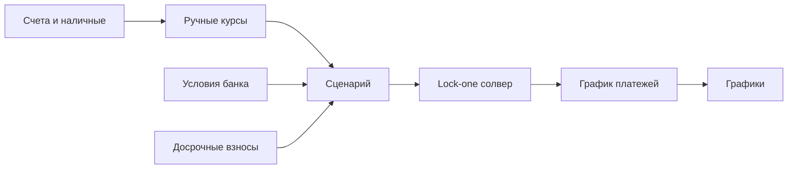

# Ипотечный калькулятор

**Личное веб-приложение без бэкенда.** Данные живут в браузере (`localStorage`) и выгружаются в JSON. Интерфейс на русском.

## Суть продукта

Это не «ещё один калькулятор платежа», а **набор сценариев сделки**. В каждом сценарии зафиксированы все величины, кроме одной, и калькулятор вычисляет эту одну. Результат видно на графиках, а сценарий сохраняется как профиль, между профилями быстро переключаешься.

Пример: все сбережения до копейки идут на первый взнос, цена квартиры мечты задана, условия кредита выбраны из списка реальных банковских, желаемый платёж зафиксирован. Свободной остаётся **ставка рефинансирования Нацбанка**, и калькулятор показывает, при какой ставке такая сделка сходится. Это для любопытства, но так же можно вычислить первый взнос, платёж или срок.

Свободной может быть одна из величин:

| Свободная величина | Как считается |
|---|---|
| Ежемесячный платёж | формула аннуитета |
| Первый взнос / сколько ещё накопить | из платежа обратно к сумме кредита (формула) |
| Срок | формула с логарифмом, округление до целых месяцев |
| Ставка рефинансирования | численный подбор (платёж растёт вместе со ставкой, поэтому хватает деления отрезка пополам) |

## Модель данных

- **Счета:** имя, валюта (BYN / USD / EUR), сумма, флаг «не использовать на взнос».
- **Курсы:** вводятся руками как «сколько BYN за 1 USD / 1 EUR» (как у Нацбанка); любые пары считаются через BYN. Никаких API.
- **Валюта сделки:** выбирается в сценарии, все три равноправны.
- **Условия банка (карточка, руками):** название; **ставка по периодам** — список «с месяца N: фиксированная X% или ставка рефинансирования + Y п.п.» (у большинства банков льготные 6–24 мес., потом обычная ставка); период «только проценты» (мес.); запрет досрочного погашения (мес.); макс. срок, мин. первый взнос %, макс. сумма кредита; ограничения текстом («только новостройки партнёров»); источник и дата проверки. При смене ставки аннуитетный платёж пересчитывается на остаток долга и оставшийся срок. Валюта кредита — BYN (см. исследование).
- **Досрочные взносы:** список «месяц, сумма». Взнос идёт в погашение тела долга.
- **Сценарий:** название, валюта сделки, цена, выбранная карточка банка, первый взнос, желаемый платёж, текущая ставка рефинансирования, досрочные взносы, какая величина свободна. Остальные данные (счета, курсы, карточки банков) общие для всех сценариев.
- **Хранилище:** одно JSON-состояние со списком сценариев с самого начала, даже пока на экране один сценарий. Так переход к нескольким сценариям обойдётся без миграции данных.

Связи:

- `loan = price - downPayment`
- `downPayment >= price * minDownPct`
- `availableCash = sum(usable savings в валюте сделки)`
- `gapToDown = downPayment - availableCash`
- `rate = refinancingRate + margin` (или фиксированная)
- аннуитет: `P = L * r / (1 - (1+r)^-n)`, `r` — месячная ставка.

## Графики

- **«Гора переплаты»:** накопленные проценты по месяцам, кривая всегда растёт слева направо. С досрочными взносами гора ниже, это и хочется видеть.
- Остаток долга по месяцам.
- Платёж по месяцам: какая часть уходит на проценты, какая на тело долга (stacked).
- Позже: два и больше сценариев на одном графике.

Библиотека — Recharts.

## Этапы

1. **Каркас + аннуитет.** Готово: ручной ввод цены, взноса, ставки, срока; таблица, графики, автосохранение, JSON.
2. **Сбережения и валюты.** Готово: счета (флаг «на взнос»), ручные курсы к BYN, валюта сделки, «сколько есть на взнос», разрыв до взноса с полосой прогресса, кнопка «взнос = все сбережения».
3. **Условия банков.** Готово: карточки со ставкой по периодам (фикс или СР + надбавка), «только проценты», запрет досрочки (хранится, учитывается на этапе 5), лимиты, источник и отметка «проверено»; общая ставка рефинансирования; выбор карточки или ручной ставки в сценарии; предупреждения «банк так не даст»; платёж по отрезкам в итогах. Три стартовые карточки из исследования, все «не проверено».
4. **Lock-one солвер.** Готово: переключатель «Что вычисляем» (платёж / первый взнос / цена / срок / ставка), поле «Платёж не больше», вычисленное поле подсвечено; «не сходится» — понятное сообщение с причиной. «Платёж не больше» сравнивается с самым большим платежом графика.
5. **Досрочные взносы.** Готово: список взносов в сценарии (месяц, сумма, «сократить срок» по умолчанию или «уменьшить платёж»), экономия на процентах и сокращение срока, гора переплаты с пунктиром «без досрочки», досрочка в таблице и в столбиках по годам, предупреждение о запрете досрочного погашения из карточки банка.
6. **Сценарии.** Готово: вкладки сценариев (макс. платёж и переплата под названием), «+ Новый», «Копия», «Удалить»; таблица сравнения всех сценариев в валюте текущего; горы переплаты до 6 выбранных сценариев на одном графике, цвет закреплён за сценарием.
7. **Календарь.** Реальные даты платежей вместо «месяц 1…n».
8. **Хроника реального кредита.** Когда кредит будет взят: журнал фактических платежей, досрочных взносов и изменений ставки — точная переплата за пользование кредитом.

**Исследование кредитов в Минске** — сделано (первый проход): `docs/research/minsk-mortgage-2026-11.md`. Ставка рефинансирования 9,25% с 01.06.2026; рыночные ставки ~14–17%; простой кандидат по умолчанию — Белинвестбанк 14,9% / 20 лет / взнос 10%. Цифры с агрегаторов — сверить на сайтах банков перед вводом в карточки.

## Открытые вопросы

- **Сбережения разных людей.** Сейчас счета общие для всех сценариев. Если сценарии для разных людей — нужно, чтобы каждый сценарий учитывал только «свои» счета. По умолчанию пока оставляем общими; вариант решения — у каждого счёта владелец, у сценария — чьи счета учитывать.

## Не делать сейчас, держать в уме

- Страховки и комиссии банка. Когда понадобятся — простое поле «доп. расходы в месяц» и «разовые расходы при выдаче».
- Изменение ставки посреди срока в расчётах-прогнозах (в хронике реального кредита — учитывать, этап 8), транши, льготный период, рефинансирование.
- Автокурсы и синхронизация с банками.
- Налоговый вычет, инфляция, рост доходов, аренда vs ипотека.
- Округление «как в выписке» конкретного банка.
