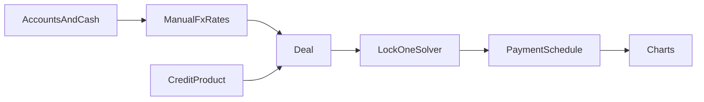

# Каркас локального ипотечного калькулятора

Это **личное веб-приложение без бэкенда**: данные живут в браузере (localStorage + экспорт JSON). Валюта сделки выбирается в UI; сбережения в любых валютах приводятся к ней по **ручным курсам**.

## Суть продукта

Не «ещё один калькулятор платежа», а **сценарий сделки с одним свободным неизвестным**.

Ты фиксируешь известные факты (цена квартиры, условия банка, сбережения, срок, ставка…). Калькулятор считает **ровно одну** незакрытую величину и показывает, как это выглядит на графике: платёж, проценты vs тело долга, разрыв до первого взноса.

Примеры режимов (все — один и тот же солвер):

- Зафиксированы цена и кредит банка → **сколько ещё накопить** на первый взнос при текущих счетах.
- Зафиксированы сбережения и ставка → **какой срок** нужен, чтобы платёж/долг уложились в ограничение.
- Зафиксированы срок и сбережения → **какая ставка** теоретически нужна (обратная задача).
- Зафиксированы цена, взнос, срок, ставка → **ежемесячный платёж** и полная переплата.

## Модель данных

**Сбережения:** список счетов/налички: имя, валюта, сумма, опционально «не использовать на взнос». Итог в валюте сделки = сумма `amount * rateToDeal`.

**Курсы:** таблица пар к валюте сделки, вводится вручную (никаких API на первом этапе).

**Кредитный продукт (карточка банка, руками):** название, валюта кредита (= валюта сделки на v1), тип графика (`annuity` | `differentiated`), ставка % годовых, срок (мес), мин. первый взнос %, макс. сумма/LTV, комиссии/страховка как надбавка к платежу или к сумме кредита (пока простые поля, без юридической модели).

**Сделка:** цена объекта, выбранный продукт, первый взнос (сумма или %), желаемый платёж (если это ограничение), дата старта.

**Состояние солвера:** у каждой величины статус `locked` | `free`. Ровно одна `free`. Остальные — вход. Выход — число + статус «неразрешимо / вне лимитов банка».

Связи (ядро, без экзотики):

- `loan = price - downPayment`
- `downPayment >= price * minDownPct`
- `availableCash = sum(usable savings in deal currency)`
- `gapToDown = downPayment - availableCash`
- график: аннуитет `P = L * r / (1 - (1+r)^-n)` или дифференцированный `principal/n + interest on remainder`; `r` — месячная ставка.

## Понятное ядро (порядок работ)

1. **Скелет приложения:** Vite + React + TypeScript, один экран, без роутера.
2. **Чистый расчётный модуль** (без UI): типы, аннуитетный график, суммы процентов/тела, тесты на известных цифрах.
3. **Солвер v1** с тремя свободными переменными на выбор: платёж, первый взнос (или gap), срок. Ставка — отдельная сложная задача (см. ниже).
4. **Черновой UI:** поля сделки + список счетов + курсы + переключатель «что считаем» + таблица графика + простая диаграмма (Recharts: stacked bar/area «проценты / тело» по месяцам или годам).
5. **Сохранение** в `localStorage`, кнопка «скачать JSON».

Стек выбран под визуализации. UI на русском.

Структура:

- `src/domain/` — типы, график, солвер, FX
- `src/state/` — одно JSON-состояние приложения
- `src/ui/` — секции: сбережения, продукты, сделка, график
- `src/app.tsx` — сборка экрана

## Этапы

**Этап 0 — этот план.** Вопросы себе, договорённости, todo на потом.

**Этап 1 — каркас + аннуитет.** Скелет, график платежей, диаграмма процентов/долга, ручной ввод цены/ставки/срока/взноса.

**Этап 2 — сбережения и FX.** Счета, курсы, «сколько есть на взнос», gap на диаграмме.

**Этап 3 — продукты банка.** Несколько карточек условий, выбор продукта в сделке, проверка мин. взноса и потолка кредита.

**Этап 4 — lock-one солвер.** UI «замочков» на полях; невалидные комбинации подсвечивать, не падать.

**Этап 5 — полировка.** Сравнение 2 продуктов на одном графике, досрочка, страховка как часть платежа — только после ядра.

## Вопросы, на которые тебе ответить (чтобы понять «готовый результат»)

Закрой коротко в чате — от этого зависит солвер и UI, не стек.

- Какие валюты реально есть на счетах и какая чаще всего валюта сделки?
- Платёж считаем **до** страховки/комиссий или они часть «сколько уходит в месяц»?
- Первый взнос — только ликвидность или ещё «эту кубышку не трогаем» (уже заложено флагом на счёте)?
- Нужен ли дифференцированный график в первой рабочей версии или хватит аннуитета?
- Ограничение «комфортный платёж» — жёсткий потолок или просто подсказка на графике?
- Один активный сценарий или сразу несколько сохраняемых вариантов квартиры/банка?
- Дата и календарь: платежи с 1-го числа, или достаточно «месяц 1…n» без календаря?
- Что считать успехом v1: «я вижу gap до взноса и график по реальной ставке банка» — или обязательно обратный расчёт ставки?

## Сложные задачи — не делать в v1, держать в уме

- Обратный расчёт **ставки** (нет закрытой формулы; численный подбор, края, несколько корней).
- Обратный расчёт срока при дифференцированном графике и при досрочке.
- Плавающая ставка, транши, льготный период, рефинанс середины срока.
- Автокурсы ЦБ/банков, синхронизация брокерских счетов.
- Налоговый вычет, инфляция, рост доходов, аренда vs ипотека.
- Точная банковская схема: страхование жизни/залога, сборы за выдачу, округление как в выписке конкретного банка.
- Досрочное погашение (сокращение срока vs платежа) и пересчёт графика.
- Сравнение многих банков на одном дашборде.

## Текущее состояние

Сделано: каркас Vite + React + TS (русский UI, один экран: цена, взнос, ставка, срок → платёж, переплата, помесячная таблица) и модуль `src/domain` (аннуитетный график + тесты на известных цифрах, `npm test`).

Дальше: диаграмма проценты/долг (Recharts), сохранение в `localStorage` и экспорт JSON — это закрывает этап 1. Продуктовые ответы из списка выше можно прислать в любой момент — подстроим солвер, не переписывая каркас.