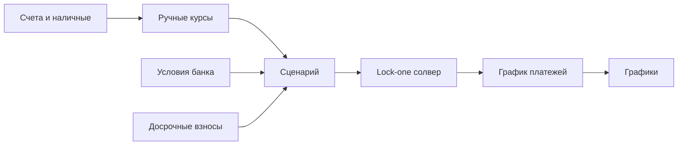

# Ипотечный калькулятор

**Личное веб-приложение без бэкенда.** Данные живут в браузере (`localStorage`) и выгружаются в JSON. Интерфейс на русском.

## Суть продукта

Это не «ещё один калькулятор платежа», а **набор сценариев сделки**. В каждом сценарии зафиксированы все величины, кроме одной, и калькулятор вычисляет эту одну. Результат видно на графиках, а сценарий сохраняется как профиль, между профилями быстро переключаешься.

Пример: все сбережения до копейки идут на первый взнос, цена квартиры мечты задана, условия кредита выбраны из списка реальных банковских, желаемый платёж зафиксирован. Свободной остаётся **ставка рефинансирования Нацбанка**, и калькулятор показывает, при какой ставке такая сделка сходится. Это для любопытства, но так же можно вычислить первый взнос, платёж или срок.

Свободной может быть одна из величин:

| Свободная величина | Как считается |
|---|---|
| Ежемесячный платёж | формула аннуитета |
| Первый взнос / сколько ещё накопить | из платежа обратно к сумме кредита (формула) |
| Срок | формула с логарифмом, округление до целых месяцев |
| Ставка рефинансирования | численный подбор (платёж растёт вместе со ставкой, поэтому хватает деления отрезка пополам) |

## Модель данных

- **Счета:** имя, валюта (BYN / USD / EUR), сумма, флаг «не использовать на взнос».
- **Курсы:** вводятся руками, к валюте сделки. Никаких API.
- **Валюта сделки:** выбирается в сценарии, все три равноправны.
- **Условия банка (карточка, руками):** название, тип ставки (`fixed` — фиксированная, `refinancing+margin` — ставка рефинансирования + надбавка), надбавка или ставка в %, срок, мин. первый взнос %, макс. сумма кредита.
- **Досрочные взносы:** список «месяц, сумма». Взнос идёт в погашение тела долга.
- **Сценарий:** название, валюта сделки, цена, выбранная карточка банка, первый взнос, желаемый платёж, текущая ставка рефинансирования, досрочные взносы, какая величина свободна. Остальные данные (счета, курсы, карточки банков) общие для всех сценариев.
- **Хранилище:** одно JSON-состояние со списком сценариев с самого начала, даже пока на экране один сценарий. Так переход к нескольким сценариям обойдётся без миграции данных.

Связи:

- `loan = price - downPayment`
- `downPayment >= price * minDownPct`
- `availableCash = sum(usable savings в валюте сделки)`
- `gapToDown = downPayment - availableCash`
- `rate = refinancingRate + margin` (или фиксированная)
- аннуитет: `P = L * r / (1 - (1+r)^-n)`, `r` — месячная ставка.

## Графики

- **«Гора переплаты»:** накопленные проценты по месяцам, кривая всегда растёт слева направо. С досрочными взносами гора ниже, это и хочется видеть.
- Остаток долга по месяцам.
- Платёж по месяцам: какая часть уходит на проценты, какая на тело долга (stacked).
- Позже: два и больше сценариев на одном графике.

Библиотека — Recharts.

## Этапы

1. **Каркас + аннуитет.** Скелет, график платежей, ручной ввод цены, ставки, срока, взноса. Осталось: графики, сохранение, JSON.
2. **Сбережения и валюты.** Счета, курсы, «сколько есть на взнос», разрыв до взноса.
3. **Условия банков.** Карточки, выбор карточки в сценарии, проверка мин. взноса и лимита кредита.
4. **Lock-one солвер.** «Замочки» на полях; невозможные комбинации подсвечивать, не падать.
5. **Досрочные взносы.** Пересчёт графика и переплаты, гора переплаты с досрочкой и без.
6. **Сценарии.** Список профилей, быстрое переключение, сравнение.
7. **Календарь.** Реальные даты платежей вместо «месяц 1…n».

## Открытые вопросы

- **Досрочный взнос:** что уменьшать — срок (платёж тот же, кредит закрывается раньше) или платёж (срок тот же)? По умолчанию сделаем переключатель на каждый взнос, а начнём с сокращения срока.
- **Тип графика:** аннуитет (платёж одинаковый весь срок) или дифференцированный (тело долга гасится равными частями, платёж в начале выше и потом снижается). Пока делаем только аннуитет; дифференцированный добавим, если банк его предлагает.
- **Плавающая ставка:** если ставка = рефинансирование + надбавка, Нацбанк может изменить её посреди срока. Пока считаем одну ставку на весь срок.

## Не делать сейчас, держать в уме

- Страховки и комиссии банка. Когда понадобятся — простое поле «доп. расходы в месяц» и «разовые расходы при выдаче».
- Изменение ставки посреди срока, транши, льготный период, рефинансирование.
- Автокурсы и синхронизация с банками.
- Налоговый вычет, инфляция, рост доходов, аренда vs ипотека.
- Округление «как в выписке» конкретного банка.
