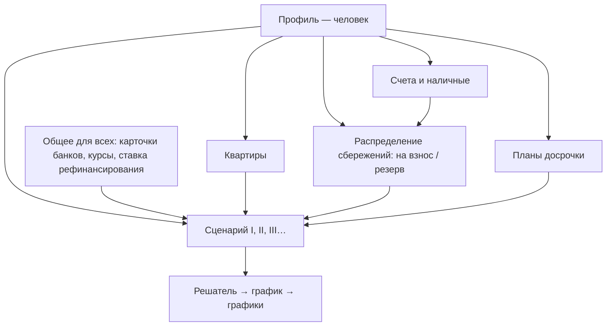

# Ипотечный калькулятор

**Личное веб-приложение без бэкенда.** Данные живут в браузере (`localStorage`) и выгружаются в JSON. Интерфейс на русском.

## Суть продукта

Это не «ещё один калькулятор платежа», а **набор сценариев сделки**. В каждом сценарии зафиксированы все величины, кроме одной, и калькулятор вычисляет эту одну. Результат видно на графиках, а сценарий сохраняется как профиль, между профилями быстро переключаешься.

Пример: все сбережения до копейки идут на первый взнос, цена квартиры мечты задана, условия кредита выбраны из списка реальных банковских, желаемый платёж зафиксирован. Свободной остаётся **ставка рефинансирования Нацбанка**, и калькулятор показывает, при какой ставке такая сделка сходится. Это для любопытства, но так же можно вычислить первый взнос, платёж или срок.

Свободной может быть одна из величин:

| Свободная величина | Как считается |
|---|---|
| Ежемесячный платёж | формула аннуитета |
| Первый взнос / сколько ещё накопить | из платежа обратно к сумме кредита (формула) |
| Срок | формула с логарифмом, округление до целых месяцев |
| Ставка рефинансирования | численный подбор (платёж растёт вместе со ставкой, поэтому хватает деления отрезка пополам) |

## Модель данных

Вложенность «матрёшкой»: **профиль → сценарии → компоненты**.

- **Общее для всех профилей:** карточки банков, курсы валют (ручные, «BYN за 1 USD / 1 EUR»), ставка рефинансирования.
- **Профиль** — человек: имя, свои счета, свои компоненты и сценарии. Переключается в углу экрана.
- **Компоненты** — общие кирпичики, на которые ссылаются сценарии. Поменял компонент — пересчитались все сценарии с ним; рядом видно «используется в I, III»; «Сделать копию» — чтобы поменять только в одном.
  - **Квартира:** название, валюта (= валюта сделки), цена.
  - **Кредит:** карточка банка (общая) или своя ставка; срок — у сценария.
  - **Распределение сбережений:** сколько оставить в резерве «на чёрный день»; первый взнос = сбережения с флагом «на взнос» − резерв.
  - **План досрочки:** разовые взносы и повторяющиеся («каждые N мес. по X с месяца A по месяц B»).
- **Сценарий:** номер (римские цифры), квартира, кредит, срок, первый взнос (из распределения сбережений или своей суммой), план досрочки, что вычисляем, «платёж не больше».
- **Хранилище:** одно JSON-состояние в `localStorage` + выгрузка в файл. Личные данные в репозиторий не попадают.

Связи:

- `loan = price - downPayment`
- `downPayment >= price * minDownPct`
- `availableCash = sum(usable savings в валюте сделки)`
- `gapToDown = downPayment - availableCash`
- `rate = refinancingRate + margin` (или фиксированная)
- аннуитет: `P = L * r / (1 - (1+r)^-n)`, `r` — месячная ставка.

## Графики

- **«Гора переплаты»:** накопленные проценты по месяцам, кривая всегда растёт слева направо. С досрочными взносами гора ниже, это и хочется видеть.
- Остаток долга по месяцам.
- Платёж по месяцам: какая часть уходит на проценты, какая на тело долга (stacked).
- Позже: два и больше сценариев на одном графике.

Библиотека — Recharts.

## Этапы

1. **Каркас + аннуитет.** Готово: ручной ввод цены, взноса, ставки, срока; таблица, графики, автосохранение, JSON.
2. **Сбережения и валюты.** Готово: счета (флаг «на взнос»), ручные курсы к BYN, валюта сделки, «сколько есть на взнос», разрыв до взноса с полосой прогресса, кнопка «взнос = все сбережения».
3. **Условия банков.** Готово: карточки со ставкой по периодам (фикс или СР + надбавка), «только проценты», запрет досрочки (хранится, учитывается на этапе 5), лимиты, источник и отметка «проверено»; общая ставка рефинансирования; выбор карточки или ручной ставки в сценарии; предупреждения «банк так не даст»; платёж по отрезкам в итогах. Три стартовые карточки из исследования, все «не проверено».
4. **Lock-one солвер.** Готово: переключатель «Что вычисляем» (платёж / первый взнос / цена / срок / ставка), поле «Платёж не больше», вычисленное поле подсвечено; «не сходится» — понятное сообщение с причиной. «Платёж не больше» сравнивается с самым большим платежом графика.
5. **Досрочные взносы.** Готово: список взносов в сценарии (месяц, сумма, «сократить срок» по умолчанию или «уменьшить платёж»), экономия на процентах и сокращение срока, гора переплаты с пунктиром «без досрочки», досрочка в таблице и в столбиках по годам, предупреждение о запрете досрочного погашения из карточки банка.
6. **Сценарии.** Готово: вкладки сценариев (макс. платёж и переплата под названием), «+ Новый», «Копия», «Удалить»; таблица сравнения всех сценариев в валюте текущего; горы переплаты до 6 выбранных сценариев на одном графике, цвет закреплён за сценарием.
7. **Профили и компоненты.** Готово: формат v7 (модель выше), переключатель профиля в углу, сценарий собирается из компонентов (квартира, кредит, источник первого взноса — своя сумма или распределение сбережений с резервом, план досрочки с разовыми и повторяющимися взносами), «используется в сценариях I, III», копия компонента, римские номера сценариев, переход к сценарию из таблицы сравнения. Старые данные переносятся в профиль «Я».
8. **Удобство.** Готово: поля чисел с разрядами («300 000», «9,25»; понимают пробелы, запятую и точку; ↑/↓ — шаг); при наведении на любую сумму (и на поле суммы) — она в двух других валютах по ручным курсам; римские номера сценариев; переключение сценариев: вкладки, плавающая панель при прокрутке, таблица сравнения, номера «в сценариях I, III» у компонентов.
9. **Публикация.** Готово: сборка с относительными путями, `.github/workflows/deploy-pages.yml` (тесты → сборка → Pages при push в main), демо-профиль «Гость (пример)» с четырьмя сценариями и приветственной подсказкой, `.gitignore` для выгрузок `ipoteka-*.json` и `private/`, README. Остаётся пользователю: сделать репозиторий публичным и включить Pages (Source: GitHub Actions).
10. **Стиль.** Готово: цветовые токены и тёмная тема по настройке системы (и у графиков), появление карточек, плавное «докручивание» итоговых чисел со вспышкой, «Платёж не больше» всегда виден — метка «запас» / «выше желаемого», красная рамка у полей, нарушающих условия банка, разницы с текущим сценарием в таблице сравнения. Учитывается «уменьшить движение» в системе.
11. **Календарь.** Готово: необязательная дата выдачи у сценария (формат v8). С датой — платёж каждый месяц в тот же день (нет такого числа — последний день месяца), колонка «Дата» в таблице, ось «горы» по календарным годам, «по годам» — календарные годы, первый/последний платёж в итогах, отрезки платежа датами, даты у месяцев досрочки и окончания в сравнении. Без даты — как раньше «месяц 1…n». Проценты по-прежнему ставка/12 за месяц (по фактическим дням — в хронике, этап 12).
12. **Хроника реального кредита.** Готово (формат v9): у профиля — реальные кредиты (сумма, ставка, срок, дата выдачи, способ счёта дней) и журнал событий: платёж (с необязательной разбивкой из выписки банка), досрочный взнос, смена ставки. Проценты по фактическим дням с округлением до копеек на каждой операции; расхождение с выпиской видно; итоги «на сегодня», прогноз остатка, сравнение с договором без досрочки, график факт / прогноз / договор; «заполнить плановыми платежами по сегодня».

**Исследование кредитов в Минске** — сделано (первый проход): `docs/research/minsk-mortgage-2026-11.md`. Ставка рефинансирования 9,25% с 01.06.2026; рыночные ставки ~14–17%; простой кандидат по умолчанию — Белинвестбанк 14,9% / 20 лет / взнос 10%. Цифры с агрегаторов — сверить на сайтах банков перед вводом в карточки.

**Проверка условий по сайтам банков** (02.11.2026): `docs/research/minsk-mortgage-2026-11-verified.md`. Главный вывод — тип графика важнее рекламной ставки: на кредите 150 000 BYN / 20 лет дифференцированный ~215–220 тыс. переплаты против ~300–310 тыс. у аннуитета. Дифференцированный график добавлен (формат v10): тип графика в карточке банка, выбор в сценарии («как в банке» / аннуитет / дифференцированный) и в реальном кредите.

## Открытые вопросы

Пока нет.

## Не делать сейчас, держать в уме

- Страховки и комиссии банка. Когда понадобятся — простое поле «доп. расходы в месяц» и «разовые расходы при выдаче».
- Изменение ставки посреди срока в расчётах-прогнозах (в хронике реального кредита — учитывать, этап 12), транши, льготный период, рефинансирование.
- Автокурсы и синхронизация с банками.
- Налоговый вычет, инфляция, рост доходов, аренда vs ипотека.
- Округление «как в выписке» конкретного банка.
